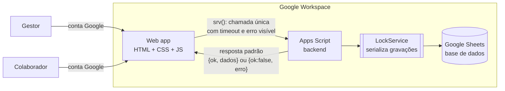

# Gestão de escalas e folgas

Web app para planejar e consultar a escala de trabalho, folgas, plantões e ausências de uma equipe de atendimento distribuída em duas unidades.

**Status:** em produção · **Stack:** Google Apps Script (web app) + Google Sheets · **Meu papel:** desenho da solução, desenvolvimento, testes, implantação e evolução

> Documentação conceitual. Sem código, dados reais ou identificação da organização.

---

## O problema

A escala era montada e divulgada de forma manual. Com turnos que atravessam a madrugada, plantões de fim de semana, férias e banco de horas, isso gerava:

- Dúvidas diárias sobre **quem está trabalhando agora** e em qual horário.
- Conflitos e esquecimentos de folga, sem histórico confiável.
- Uma primeira versão do sistema em que **a gravação falhava em silêncio**: o gestor lançava a folga, nada acontecia e ninguém percebia.

## A solução

Um web app com dois perfis de uso:

- **Gestor (admin):** lança folgas, plantões, férias, banco de horas e ausências, e acompanha a operação do dia.
- **Colaborador (atendente):** consulta a escala, as folgas do mês e os horários dos setores, só para leitura.

## Arquitetura

### Modelo de dados (conceitual)

| Aba | Conteúdo |
|---|---|
| Funcionários | Nome, e-mail corporativo, unidade e perfil (admin ou atendente) |
| Horários | Turno padrão de cada pessoa: entrada, saída e pausas |
| Eventos | Folgas, plantões, férias, banco de horas e ausências por data (plantão pode ter horário próprio) |
| Setores | Horário de funcionamento de cada setor e responsável |
| Protocolos | Marcações operacionais do dia, com validade calculada |

## Funcionalidades

- **Operação do dia:** quem está em turno, em pausa ou de folga, agrupado por unidade.
- **Folgas do mês:** visão de calendário para planejamento.
- **Setores:** horários de funcionamento, só leitura para a equipe e editável pelo gestor.
- **Plantão com horário próprio:** substitui o turno padrão só naquele dia.
- **Diagnóstico:** botão que confere conta, permissão, fuso horário e estrutura da planilha, e testa uma gravação real após cada implantação.

## Decisões de design

| Decisão | Por quê |
|---|---|
| **Nenhuma falha silenciosa:** toda função do backend devolve `{ok, ...}` e toda chamada do front passa por um único wrapper com timeout | Resolveu o bug original em que a gravação "não fazia nada" sem avisar ninguém. |
| Colunas localizadas **pelo nome do cabeçalho**, não pela posição | Reorganizar a planilha não quebra o sistema. Se faltar uma coluna, o erro diz qual. |
| **Datas gravadas como texto** (AAAA-MM-DD) e fuso horário lido da planilha | Evita o erro clássico de o lançamento aparecer no dia anterior por conversão de fuso. |
| Antes de apagar um evento, **reconfere data + nome + tipo** | Outro gestor pode ter editado a planilha entre a leitura e a ação. |
| **Lock** nas gravações | Dois gestores gravando ao mesmo tempo não se sobrescrevem. |
| Turnos que atravessam a meia-noite tratados explicitamente | Plantão das 18h às 00h05 pertence a dois dias do calendário. |
| Perfil definido pelo e-mail da conta Google | Sem senha própria e com controle de acesso centralizado. |

## Qualidade e implantação

- **Testes automatizados** do backend em Node.js, rodando contra uma planilha simulada em memória: adicionar, remover e alternar folga, permissões, fuso horário, validações e planilha malformada.
- **Prévia local** do app completo com dados fictícios, para testar sem mexer no ambiente real.
- **Checklist de implantação** manual, porque a política do Workspace da empresa bloqueia deploy automatizado, finalizado pelo botão de Diagnóstico.

## Governança e boas práticas

- **ITIL:** gestão da força de trabalho e talentos (disponibilidade da equipe) e gestão de mudanças (implantação versionada com verificação).
- **COBIT, APO07:** gestão de recursos humanos (planejamento de capacidade da equipe).
- **Controles:** privilégio mínimo, integridade de dados, controle de concorrência e trilha de verificação pós-implantação.

## O que aprendi

- O pior bug é o que **não avisa**. Tornar o erro visível foi mais importante que qualquer funcionalidade nova.
- **Data e fuso horário** são uma fonte clássica de erro; vale tratar como regra de projeto desde o início.
- Testes e prévia local deram segurança para evoluir um sistema em produção **sem parar a operação**.

---

## Outros estudos de caso

- [Pesquisa de satisfação (NPS) pós-visita técnica](https://github.com/alexpernaoficial/pesquisa-nps-atendimento)
- [Arena de Atendimento: ranking gamificado](https://github.com/alexpernaoficial/arena-ranking-atendimento)
- [Programa de treinamento e integração](https://github.com/alexpernaoficial/treinamento-integracao-suporte)

## Sobre mim

**Alex Perna**, suporte técnico N2 e liderança de equipe em provedor de internet (ISP). Estudando ITIL, COBIT 2019 e ISO/IEC 27001, e cursando Ciência da Computação.

[LinkedIn](https://www.linkedin.com/in/alexpernaoficial/)
